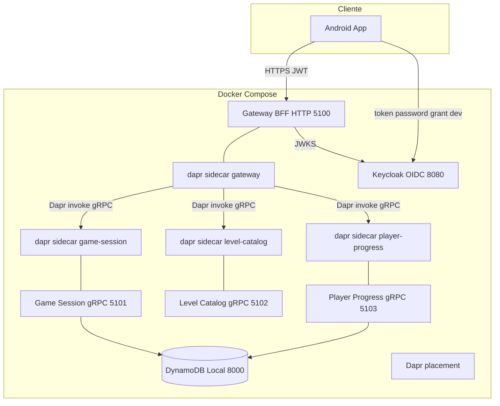

# C4 — Nível 2 (Containers)

Runtime local via Docker Compose (`deploy/docker/docker-compose.yml`).

| Container | Papel |
|-----------|--------|
| **Gateway** | BFF REST, JWT, MediatR, invoca serviços via **Dapr** (padrão) ou gRPC direto (fallback) |
| **Game Session** | Sessão e regras do puzzle |
| **Level Catalog** | Níveis procedural por ID numérico |
| **Player Progress** | Progresso por `sub` OIDC |
| **Keycloak** | OIDC local (realm `arrow-puzzle`) |
| **DynamoDB Local** | Sessões e progresso |

Nome comercial na UI: variável `Product__DisplayName` no gateway (ver README).
