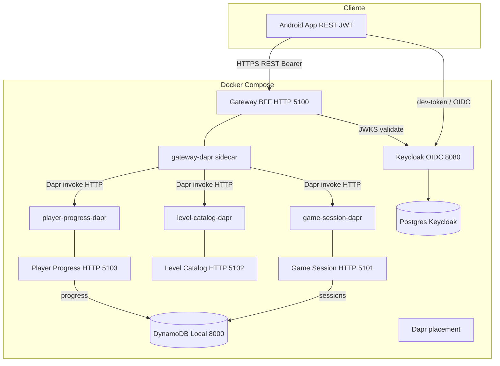

# C4 — Nível 2 (Containers)

Runtime local via Docker Compose ([`deploy/docker/docker-compose.yml`](../../deploy/docker/docker-compose.yml)).

## Fluxo de invocação (padrão)

1. Android chama apenas o **Gateway** (`/api/v1/*`).
2. Gateway usa **MediatR** e adapters **Dapr** (`Dapr__Enabled: true`).
3. Sidecar recebe invoke e encaminha ao app via **app channel** (`/dapr/*` + JSON Protobuf).
4. Fallback diagnóstico: overlay [`docker-compose.direct-grpc.yml`](../../deploy/docker/docker-compose.direct-grpc.yml) — gRPC direto, Dapr off.

## Superfícies expostas (host)

| Porta | Serviço | Uso |
|-------|---------|-----|
| 5100 | Gateway | App Android, `/health`, `/scalar`, `/openapi/v1.json`, `/metrics` |
| 5101–5103 | Microsserviços | Health + `/metrics` (dev); tráfego app via Dapr |
| 8080 | Keycloak | Login / tokens |
| 8000 | DynamoDB Local | Debug SDK (opcional) |

## Containers

| Container | Papel |
|-----------|--------|
| **Gateway** | BFF REST, JWT OIDC, OpenAPI/Scalar, correlation + Prometheus |
| **Game Session** | Sessão, moves, vitória; owner `userId` |
| **Level Catalog** | Níveis procedural (`001`, …), guarda solvabilidade |
| **Player Progress** | Níveis completos por `sub` OIDC |
| **Keycloak + Postgres** | IdP local, realm `arrow-puzzle` |
| **DynamoDB Local** | Sessões e progresso (in-memory/shared) |
| **Dapr placement + sidecars** | Invocação entre apps no Compose |

Nome comercial na UI: `Product__DisplayName` / `.env` `PRODUCT_DISPLAY_NAME` — ver [PRODUCT_DISPLAY_NAME.md](../PRODUCT_DISPLAY_NAME.md).

Contrato HTTP público: [docs/api/README.md](../api/README.md).
